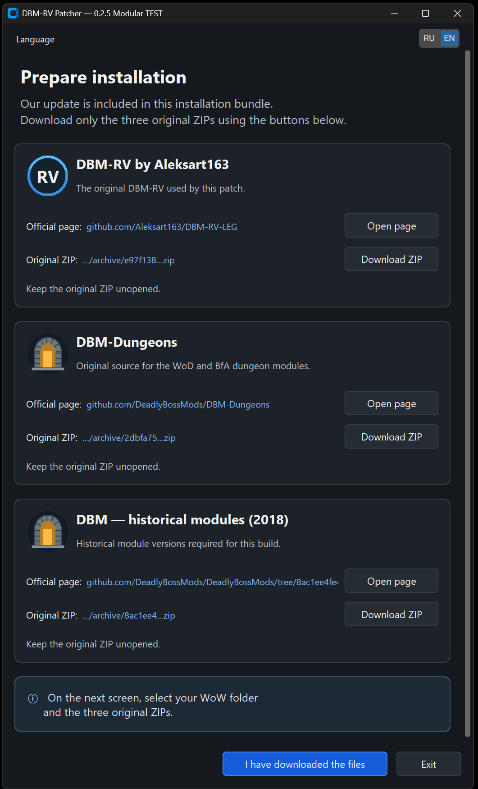
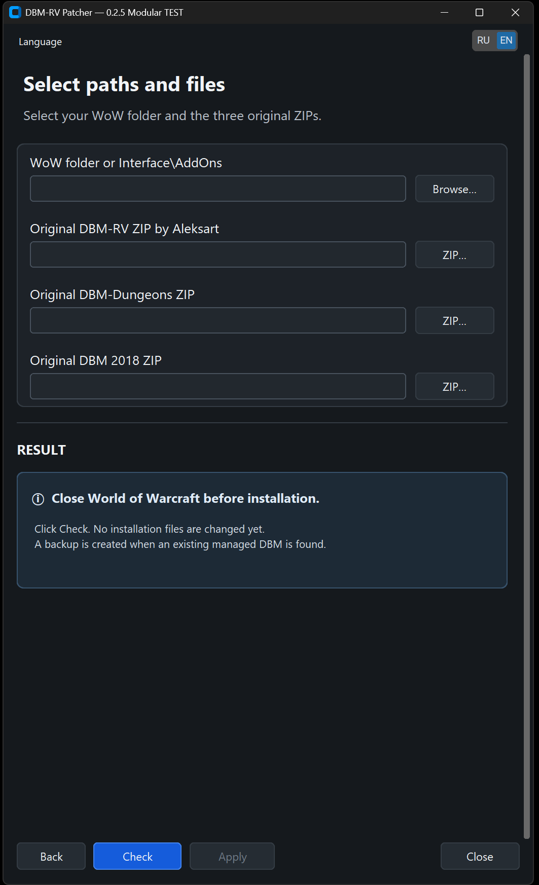
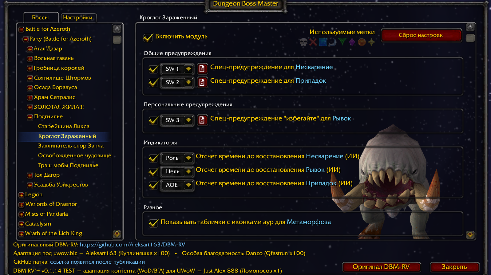

# DBM RV*+ — UWoW Legion 7.3.5

**0.1.14 TEST · Предварительный выпуск · Установщик для Windows x64**

Неофициальная адаптация DBM для UWoW Legion 7.3.5. Основа проекта — DBM-RV от **Aleksart163**, дополненная модулями подземелий и изменениями под особенности сервера.

В этой версии собраны модули Legion, подземелий Warlords of Draenor и Battle for Azeroth. Для части доступного на сервере контента внесены исправления событий, предупреждений и таймеров по результатам игровых прогонов.

> Это тестовая версия для расширенной проверки игроками. Наличие подземелья в списке DBM не означает, что все его механики и таймеры уже проверены на UWoW.

## Что входит

- Основа DBM-RV для Legion.
- Модули подземелий Warlords of Draenor.
- Модули подземелий Battle for Azeroth, кроме исключённого из проекта мегаподземелья «Операция: Мехагон».
- Исправления совместимости и серверных особенностей.
- Дополнительные звуковые оповещения.
- Установщик с русским и английским интерфейсом.

Среди подземелий, по которым проводились игровые проверки: **Вольная гавань, Подгнилье, Вечное Цветение, Депо Мрачных Путей, Некрополь Призрачной Луны**, а также ряд подземелий Legion.

Остальные модули WoD и BfA включены с доступными механиками для последующей адаптации, когда соответствующее подземелье станет доступно на сервере. Их серверные тайминги могут потребовать настройки.

## Почему установка устроена именно так

Проект использует материалы из трёх исходников:

1. **DBM-RV от Aleksart163** — основа для Legion.
2. **DBM-Dungeons** — модули и механики подземелий WoD и BfA.
3. **Историческая версия DBM 2018 года** — версии модулей, необходимые для совместимости этой сборки.

На UWoW встречаются механики и реализации из разных версий игры. Для получения нужного результата используются конкретные версии всех трёх исходников.

Мы распространяем **патчер и собственный пакет обновления**, а исходные архивы пользователь скачивает отдельно со страниц авторов. Патчер проверяет их и собирает итоговый DBM на компьютере пользователя.

**Наш Update Pack уже включён в установочный комплект. Дополнительно скачивать его не нужно.**

## Установка

1. Скачайте установочный ZIP из раздела **Releases** этого репозитория.
2. Полностью распакуйте его в отдельную папку. Сохраните структуру комплекта: EXE, папка `UpdatePacks` и остальные файлы должны оставаться вместе.
3. Закройте World of Warcraft.
4. Запустите `DBM-RV-Patcher.exe`.
5. Выберите язык интерфейса.
6. На странице подготовки скачайте **три исходных ZIP-архива** по кнопкам установщика. Не распаковывайте их.
7. Перейдите дальше и укажите папку WoW либо `Interface\AddOns`, затем выберите три скачанных ZIP.
8. Нажмите **«Проверить» / Check**. На этом этапе установленные файлы ещё не заменяются.
9. После успешной проверки нажмите **«Применить» / Apply** и дождитесь завершения.

Используйте именно архивы по ссылкам установщика. Произвольная другая версия исходника может не пройти проверку.

**Не копируйте три донорских архива в AddOns вручную и не устанавливайте их поверх друг друга.** Их объединение выполняет патчер.

## Обновление и резервная копия

При обнаружении существующего DBM, который заменяется установщиком, создаётся резервная копия. Путь к ней указан в результате установки.

Сохраните эту папку до завершения игровых проверок. Не удаляйте старый DBM вручную перед установкой.

## Скриншоты

### Подготовка установки

### Выбор папки игры и исходных архивов

### Интерфейс в игре

## Статус тестирования

Сборка прошла проверки воспроизводимости, установки, резервного копирования и отката. В ходе разработки проводились реальные игровые прогоны подземелий с сопоставлением серверных событий и действий DBM по нескольким источникам логов.

Исправления вносились по подтверждённым наблюдениям. Покрытие игровых проверок различается: часть контента проверялась неоднократно, остальные модули включены для дальнейшей адаптации. Выпуск распространяется как TEST/prerelease для расширенного тестирования.

## Как сообщить о проблеме

Создайте **Issue** и укажите:

- версию пакета и установщика;
- подземелье, босса, сложность и уровень ключа;
- название способности или SpellID;
- что произошло и что ожидалось;
- примерное время события.

По возможности приложите логи, текст Lua-ошибки, скриншот или видео. По одному сообщению «таймер неправильный» обычно невозможно отличить ошибку от задержки способности, смены фазы или условий срабатывания.

## Авторы и благодарности

- **Aleksart163** — автор DBM-RV, на котором основан проект.
- **Deadly Boss Mods и авторы соответствующих модулей** — исходные механики и модули DBM.
- **Just Alex 888** — адаптация DBM RV*+ для UWoW, сборка и игровые проверки.

Продолжение проекта согласовано с Aleksart163 в отношении его собственного вклада: [обсуждение и разрешение автора](https://github.com/Aleksart163/DBM-RV-LEG/issues/62#issuecomment-6072498965).

DBM RV*+ — неофициальный проект. Лицензии и права авторов исходников, библиотек и медиа сохраняются. Необходимые лицензионные тексты и уведомления включены в комплект.

## Версии выпуска

**Игровой пакет:** 0.1.14 TEST  
**Установщик:** 0.2.5 Modular TEST  
**Клиент:** World of Warcraft Legion 7.3.5 / Interface 70300  
**Установщик:** Windows x64
